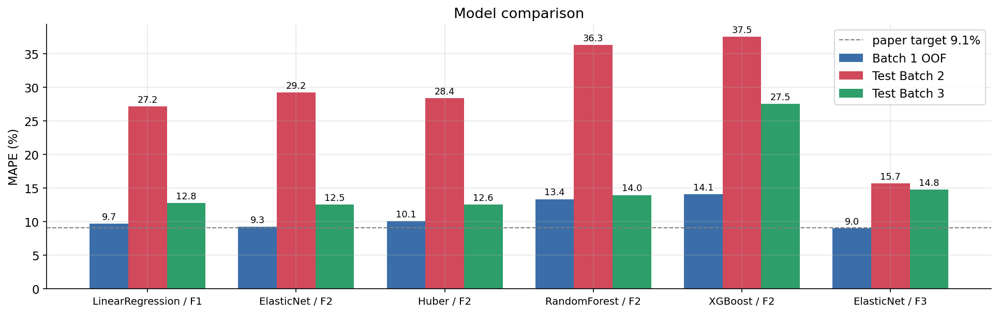
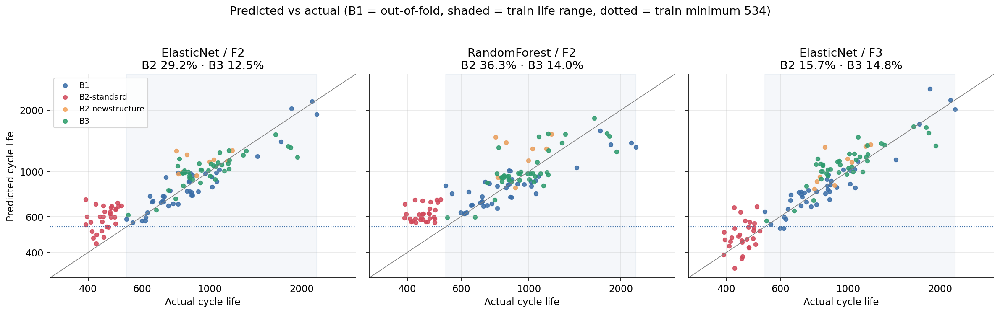
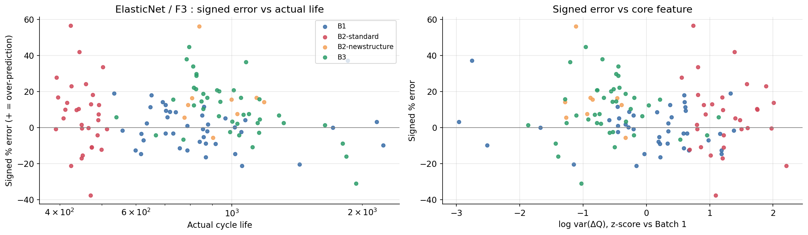

# ESS 배터리 수명 예측

## 목적

ESS 배터리 교체 비용은 전체 CAPEX 의 30~40% 를 차지합니다. 이 프로젝트는 **운전 초기 100 사이클 데이터만으로 셀의 수명을 예측**해, 수개월이 걸리는 수명 시험 없이 셀 선별과 교체 계획에 활용하는 것을 목표로 합니다.

## 프로젝트 개요

- 데이터셋 : MIT-Stanford Battery Dataset (Severson et al., Nature Energy 2019) · A123 LFP/graphite 18650, 공칭 1.1Ah
- 학습 데이터 : Batch 1 (2017-05-12), 41셀
- 평가 데이터 : Batch 2 (2018-02-20), 39셀 · 추가 검증 Batch 3 (2018-04-12), 40셀
- 태스크 : **Regression** — Target `log10(cycle_life)`, 지표 MAPE (%), 원논문 목표 9.1%
- 결과 : 선택 모델 **ElasticNet (F3 피처셋)** — Train CV **8.5%** · Valid **8.9%** · Test B2 **15.7%** · Test B3 **14.8%**

## 파일 구조

```
├── data/
│   └── README.md                     # 데이터 다운로드·전처리·정제 규칙
├── notebooks/
│   ├── 01_EDA.ipynb                  # EDA 5개 질문 + 모델 설계 전략
│   ├── 02_feature_engineering.ipynb  # 피처 구현·검증, 정책 단위 데이터 분할
│   └── 03_modeling.ipynb             # 모델 비교, 성능 리포트, 원논문 비교, 오류 분석
├── src/
│   ├── __init__.py
│   ├── preprocess.py                 # .mat → 정제 → data/processed 캐시
│   ├── features.py                   # ΔQ(V) 통계, 사이클 요약 피처, 피처셋 정의
│   └── train.py                      # 분할·튜닝·학습·평가 파이프라인
├── results/
│   ├── model_performance.csv         # 후보 모델 8개 성능·Gap
│   ├── predictions.csv               # 셀별 예측 (Batch 1 은 out-of-fold)
│   ├── coefficients.csv              # 선형 모델 표준화 계수
│   ├── split.json                    # train / valid / test 셀 목록
│   └── figures/
├── requirements.txt
└── README.md
```

## 환경 설정

```bash
git clone https://github.com/<github-id>/skala-ds.git
cd skala-ds
python3.11 -m venv .venv && source .venv/bin/activate
pip install -r requirements.txt

# data/README.md 에 따라 .mat 3개를 data/raw/ 에 둔 뒤
python -m src.preprocess     # 원본 → data/processed 캐시 (1분 이내)
python -m src.train          # 학습·평가 → results/ (약 1분)
```

노트북은 `01 → 02 → 03` 순서로 실행합니다. `03_modeling.ipynb` 는 `src.train` 파이프라인을 직접 호출해 `results/` 를 다시 만듭니다.

## EDA

- **Cycle Life 분포**
  - Batch 1 은 534~2,237 (중앙값 842), Batch 3 는 541~1,935 로 비슷하지만, **Batch 2 는 두 집단으로 갈립니다** : standard 30셀 392~514, newstructure 9셀 777~1,186
  - 장수명(550 이상) 레이블 기준 Batch 1 은 40 : 1 로, 분류 모델의 단수명 클래스 학습이 불가능합니다
  - 핵심 발견 : **Batch 2 standard 30셀 전부가 학습 수명 범위(≥534) 아래** — 테스트는 외삽 문제이며, 이를 근거로 회귀와 log10 Target(전체 120셀 기준 왜도 1.46 → 0.27)을 선택했습니다

- **열화 곡선 분석**
  - 모든 배치에서 초반 완만 → 후반 급락하며, knee 이후 열화 속도가 knee 이전의 10~16배입니다
  - knee 는 수명의 72~79% 지점에서 나타납니다 (knee–수명 r = 0.99)
  - 핵심 발견 : **초기 100 사이클의 용량(QD)에는 수명 차이가 거의 드러나지 않아**, 조기 예측에는 더 민감한 신호가 필요합니다

- **ΔQ(V) 곡선 분석**
  - ΔQ₁₀₀₋₁₀(V) 는 3.0~3.2V(LFP 방전 평탄 구간)에서 수명이 짧을수록 더 깊고 넓습니다
  - 장수명(>1,000) vs 단수명(<500) 평균 곡선의 10~90% 밴드가 거의 겹치지 않습니다
  - 핵심 발견 : **log var(ΔQ₁₀₀₋₁₀) 가 세 배치 모두에서 log 수명과 강한 음의 상관** (r = −0.95 / −0.90 / −0.80)

- **충전 속도(C-rate)와 수명의 관계**
  - Batch 1 안에서는 고속 충전일수록 수명이 짧습니다 (평균 C-rate r = −0.78)
  - Batch 2·3 은 모든 셀이 0→80% 평균 4.8C(약 10분 충전)로 같지만 수명은 약 5배 차이 나고, 같은 정책도 배치에 따라 수명이 2~3배 다릅니다
  - 핵심 발견 : **수명을 가르는 1차 요인은 충전 정책보다 배치(시험 구조) 조건** — 정책 설정값은 일반화 피처가 아닙니다

- **추가 확인 내용**
  - 평가용 Batch 2(2018-02-20)는 데이터 원본(data.matr.io)에서 *"Low rate data used to generate figure 4"* 로 분류된 보조 실험 배치로, **원논문의 1차 테스트셋(2017-06-30)이 아닙니다**
  - Batch 2 는 IR 값의 약 18% 가 미측정(0)이며, 일부 셀은 시험 일시정지로 1개 사이클의 충전 시간이 약 3,934분으로 기록되어 있습니다

## Modeling

### 피처 엔지니어링 전략

Day 1 의 선별 원칙 — **① 배치 간 상관 부호 일관성 → ② 공선성 묶음별 대표 1개 → ③ 미래 정보·정책 설정값 제외** — 으로 피처셋을 구성했습니다.

| 피처셋 | 구성 | 근거 |
|---|---|---|
| F1 | log var(ΔQ) | 세 배치 공통 최강 신호 (원논문 Variance model) |
| F2 | F1 + skew(ΔQ), kurt(ΔQ) | 배치 간 부호가 일관된 ΔQ 통계 |
| **F3** | F2 + 충전 시간 중앙값, QD 기울기, **초기 용량 상승폭**, IR 최소, 평균 온도 | Batch 1 에서 유의하나 배치 간 부호가 바뀌는 측정 피처 |
| F3+Policy | F3 + 충전 정책 설정값 (C1, Q1, C2, 평균 C-rate) | 정책 피처 과적합 확인용 |

- **ΔQ 스파이크 보정** : b1c41 의 ΔQ 곡선에 0.07Ah 단일 점 측정 스파이크가 있어, 전압축 9점 중앙값 필터로 제거했습니다 (logvar 상관 유지, kurt 상관 +0.13 → +0.41)
- **결측** : Batch 2 의 6셀 `IR_min` 결측은 파이프라인 안에서 학습셋 중앙값으로 대체합니다
- **Day 1 대비 변경** : Day 1 에서 F2 에 넣었던 평균 충전 시간은 시험 일시정지로 생긴 시간 공백(약 3,934분)에 오염되어 있었습니다. 공백에 강건한 중앙값으로 다시 보면 배치 간 상관 부호가 바뀌어(B1 +0.81 / B2 −0.93 / B3 +0.55), 원칙 ①에 따라 F3 로 옮겼습니다

### 데이터 분할

- **Valid (Batch 1 Hold-out)** : 충전 정책을 평균 수명 순으로 정렬해 4개마다 1개 정책을 분리 → train 32셀(17정책) / valid 9셀(5정책), **정책 중복 0**
- **Train (Batch 1 CV)** : train 셀에서 정책 단위 5-fold CV — 정책을 수명 순으로 fold 에 번갈아 배정해 sklearn 버전과 무관하게 재현됩니다
- 셀마다 충전 정책이 다르고 같은 정책 셀은 수명이 비슷하므로, 정책이 train 과 valid 에 섞이면 정책 정보가 누설됩니다
- 결측 대체·스케일링·모델을 하나의 Pipeline 으로 묶어 학습 데이터에서만 fit 하고, 하이퍼파라미터는 train CV 로만 정했습니다
- Valid 성능은 train 32셀로 학습한 모델로, Test 성능은 같은 하이퍼파라미터로 **Batch 1 전체 41셀에 다시 학습한 모델**로 평가합니다

### 모델 선택 및 근거

- 후보 모델 : LinearRegression(F1), **ElasticNet**(F1·F2·F3·F3+Policy), Huber(F2), RandomForest(F2), XGBoost(F2)
- 최종 모델 : **ElasticNet / F3** (alpha 0.001, l1_ratio 0.9)
- 선택 이유
  - 선택 기준은 **Batch 1 전체 41셀의 out-of-fold MAPE** (train CV 32셀 + valid 9셀)이며, 테스트(Batch 2·3)는 사용하지 않았습니다. ElasticNet / F3 가 9.0% 로 가장 낮습니다
  - Batch 2 standard 셀은 피처·타깃 모두 학습 범위 밖의 외삽 문제이므로 **외삽이 가능한 선형 모델**이 유리하고, 41셀 소표본에는 L1/L2 정규화가 필요합니다
  - 트리 모델은 Batch 1 OOF 에서도 13~14% 로 열세이고, 학습 범위 밖을 예측하지 못합니다
- 참고 : 처음에는 Valid 9셀만으로 고르는 기준을 두었으나, 표본이 작아 CV 와 크게 어긋나는 사례(F3+Policy : Valid 7.7% vs CV 10.0%)가 있어 41셀 OOF 기준으로 바꿨습니다. 기준 변경 시점에 테스트 결과를 이미 확인한 상태였으므로 **모든 후보의 결과를 함께 공개**합니다

| 모델 | Train CV | Valid | Batch 1 OOF | Test B2 | Test B3 |
|---|---|---|---|---|---|
| LinearRegression / F1 | 9.7 | 8.7 | 9.7 | 27.2 | 12.8 |
| ElasticNet / F1 | 9.5 | 8.2 | 9.3 | 29.2 | 12.5 |
| ElasticNet / F2 | 9.5 | 8.2 | 9.3 | 29.2 | 12.5 |
| Huber / F2 | 9.7 | 10.0 | 10.1 | 28.4 | 12.6 |
| RandomForest / F2 | 13.6 | 8.0 | 13.4 | 36.3 | 14.0 |
| XGBoost / F2 | 14.3 | 12.0 | 14.1 | 37.5 | 27.5 |
| **ElasticNet / F3** | **8.5** | **8.9** | **9.0** | **15.7** | **14.8** |
| ElasticNet / F3+Policy | 10.0 | 7.7 | 10.0 | 25.0 | 12.5 |



## 성능 결과

선택 모델 : **ElasticNet / F3** (MAPE %, Gap = 뒤 단계 − 앞 단계)

| 구분 | MAPE (%) | 비고 |
|---|---|---|
| Train (Batch 1 CV) | 8.5 | 정책 단위 5-fold 평균 |
| Valid (Batch 1 Hold-out) | 8.9 | 정책 단위 Hold-out 9셀 |
| Test (Batch 2) | 15.7 | standard 15.4 / newstructure 16.7 |
| Gap (Train-Valid) | +0.4 | 과적합 없음 |
| Gap (Valid-Test) | +6.8 | 배치 간 일반화 저하 |
| Gap (Target-Test) | +6.6 | Target : 원논문 9.1% |

Batch 3 추가 검증

| 구분 | MAPE (%) | 비고 |
|---|---|---|
| Test (Batch 3) | 14.8 | 원논문 secondary test 와 같은 파일 (2018-04-12) |
| Gap (Batch2-Batch3) | −0.9 | Test B3 − Test B2, Batch 3 가 0.9%p 낮음 |
| Gap (Target-Test) | +5.7 | Batch 3 기준, 원논문 성능 비교 |

### 원논문 성능과 비교

원논문 목표 9.1% 는 Full 모델의 primary test(이상 셀 1개 제외 7.5%)와 secondary test(10.7%)의 평균과 일치합니다. **원논문 secondary test 는 2018-04-12 파일 = 본 프로젝트의 Batch 3** 이므로, Batch 3 가 같은 데이터로 비교할 수 있는 기준입니다.

| 원논문 모델 (Table 2) | Train | Primary test | Secondary test | 대응 모델 | Batch 1 OOF | Test B2 | Test B3 | Gap (B3 − Secondary) |
|---|---|---|---|---|---|---|---|---|
| Variance (logvar 1개) | 14.1 | 14.7 | 11.4 | LinearRegression / F1 | 9.7 | 27.2 | 12.8 | +1.4 |
| Discharge (6개) | 9.8 | 13.0 (10.1*) | 8.6 | ElasticNet / F2 | 9.3 | 29.2 | 12.5 | +3.9 |
| Full (9개) | 5.6 | 14.1 (7.5*) | 10.7 | ElasticNet / F3 | 9.0 | 15.7 | 14.8 | +4.1 |

\* 원논문이 이상 셀 1개를 제외하고 함께 보고한 값

| | 원논문 | 본 프로젝트 |
|---|---|---|
| 학습 | Batch 1 + 2017-06-30 배치에서 번갈아 41셀 (**두 배치**) | Batch 1 41셀 (**한 배치**) |
| Primary test | 같은 두 배치의 나머지 43셀 (학습과 같은 분포) | 2018-02-20 39셀 (보조 실험 배치, 77% 가 학습 수명 범위 밖) |
| Secondary test | 2018-04-12 40셀 | 2018-04-12 40셀 (같은 파일) |

**시사점**
- **같은 데이터(Batch 3)로 비교하면 원논문과의 차이는 +1.4~+4.1%p** 로, Test B2 기준 Gap(+6.6%p)보다 훨씬 작습니다
- Test B2 의 큰 Gap 은 모델 자체보다 **테스트 배치의 분포 이동**(수명이 학습 범위 아래)과 **단일 배치 학습**(배치 간 변동을 학습할 기회 없음)에서 주로 발생합니다
- Batch 1 내부(Train CV 8.5%, Valid 8.9%)에서는 원논문 목표 9.1% 와 같은 수준을 달성해, ΔQ 기반 조기 예측 자체는 재현되었습니다



### Day 1 전략 검증

| Day 1 판단 | 결과 | 판정 |
|---|---|---|
| 테스트는 외삽 문제 → 트리 모델 불리 | RandomForest 는 B2-standard 를 560 사이클 아래로 예측하지 못함 (실제 392~514) | 확인 |
| log var(ΔQ) 가 핵심 | ElasticNet 이 F2 의 skew·kurt 계수를 0 으로 축소 → F2 = F1 | 확인 (logvar 하나로 충분) |
| 정책 피처는 일반화에 무익 | F3+Policy 는 Batch 1 OOF 9.0 → 10.0%, B2-standard 15.4 → 28.8% 로 악화 | 확인 |
| 배치 간 부호가 바뀌는 피처(F3)는 배치 과적합 | B2 는 29.2 → 15.7% 로 개선, B3 는 12.5 → 14.8% 로 악화 | 부분 확인 — 배치마다 효과가 다른 신호 |

- F3 가 Batch 2 를 개선한 주된 요인은 **초기 용량 상승폭**(`QD_max_minus_first`)입니다. B2-standard 셀은 초기 100 사이클 동안 용량이 중앙값 0.0082Ah 상승해(B1 평균 0.0052Ah 대비 +1.9σ), "같은 ΔQ 분산이라면 초기 용량이 더 많이 오른 셀이 더 짧다"는 Batch 1 의 조건부 관계가 그대로 적용되었습니다 (예측 수명 ×0.85)

## 오류 분석



- **모델이 가장 크게 틀린 셀의 공통점**
  - **대부분 과대예측** : 테스트 오차 상위 10셀 중 8셀이 과대예측이며, 새 배치에서 수명을 체계적으로 낙관합니다 (평균 부호오차 Batch 2 +8.7%, Batch 3 +10.4%, Batch 1 OOF −0.1%)
  - **ΔQ 는 "보통"인데 실제로는 짧은 셀** : b2c2·b2c4·b2c46 은 log var(ΔQ) 가 Batch 1 분포의 상단 부근(+0.7~+1.4σ)이라 630~672 사이클로 예측했지만 실제 수명은 424~503 입니다
  - **Batch 3 는 예측이 평균 쪽으로 압축** : 부호오차와 실제 수명의 상관이 −0.60 으로, 짧은 셀은 과대예측하고 가장 긴 셀(b3c38, 1,935)은 과소예측합니다
  - **극단 피처값** : 과소예측 1위 b2c17 은 초기 용량 상승폭이 +8σ 로, 선형 외삽이 과도하게 작동했습니다
- **원인 가설**
  - 같은 ΔQ 라도 배치(시험 구조·휴지 시간·충전 프로파일)에 따라 수명 수준이 달라지는 **배치 수준 오프셋**이 있으며, 초기 100 사이클의 ΔQ 에는 충분히 드러나지 않습니다
  - 학습 데이터가 한 배치뿐이라 "배치가 바뀌면 수명 수준이 이동한다"는 변동을 학습할 수 없습니다
- **개선 방향**
  - **배치 보정** : 새 배치에서 소수 셀을 EOL 까지 시험해 절편(배치 오프셋)만 다시 맞춥니다
  - **학습 배치 다양화** : 원논문처럼 두 개 이상 배치를 섞어 학습합니다 (같은 Batch 3 기준 원논문과 차이 1~4%p)
  - **시험 조건 피처** : 휴지 시간·CV 컷오프 전류 등 배치 조건을 메타 피처로 추가합니다
  - **극단값 처리** : 피처를 학습 범위 근처로 제한하고 예측 구간을 함께 제공해, 범위 밖 셀은 "신뢰도 낮음"으로 표시합니다

## ESS 도메인 해석

- **이 모델을 실제 BESS 에 적용한다면 어떤 의사결정에 활용 가능한가?**
  - **입고 셀 선별·등급화** : 초기 100 사이클 시험만으로 셀 수명 순위를 매겨, 단수명 예상 셀을 조기 선별하고 수명이 비슷한 셀끼리 모듈을 구성합니다 (셀 간 수명 편차가 크면 가장 약한 셀이 모듈 수명을 결정)
  - **교체 계획·보증 산정** : 예측 수명과 운전 패턴으로 교체 시점과 교체 예산(CAPEX 30~40%)을 미리 계획합니다. 열화는 knee 이후 10배 이상 빨라지므로, knee 이전에 교체 일정을 잡아야 합니다
  - **충전 운영 정책** : 같은 배치 안에서는 고속 충전이 수명을 줄이므로(B1 r = −0.78), 수명 예측을 충전 프로파일 선택의 근거로 쓸 수 있습니다
- **어떤 한계가 있으며, 실 배포를 위해 추가로 필요한 것은 무엇인가?**
  - **새 배치에서 수명을 낙관적으로 예측** (Batch 2 +8.7%, Batch 3 +10.4%) → 교체가 늦어지는 방향의 오류이므로, 실 배포 시 보수적 임계값과 **로트별 보정**이 필요합니다
  - **실험실 조건과 운영 조건의 차이** : 30°C 고정, 4C 정전류 완전 방전, 고속 충전 반복 조건의 데이터입니다. 실제 ESS 는 부분 충방전, 저율 운전, 온도 변동, 캘린더 열화가 함께 일어납니다
  - **피처 취득 방법** : ΔQ(V) 는 정전류 완전 방전 곡선이 필요하므로, 운영 중에는 주기적인 진단 사이클(RPT)과 BMS 데이터 수집 파이프라인이 필요합니다
  - **단일 셀 화학·형태** : LFP 18650 한 종류이므로, 다른 화학(NCM 등)이나 대형 각형 셀에는 재학습과 검증이 필요합니다
  - **불확실성 정량화** : 셀별 예측 구간을 함께 제공하고, 운영 데이터로 주기적으로 재학습·모니터링하는 체계가 필요합니다

## 참고문헌

- Severson et al. (2019). Data-driven prediction of battery cycle life before capacity degradation. *Nature Energy*, 4, 383–391.
- 데이터 : [data.matr.io](https://data.matr.io/1/projects/5c48dd2bc625d700019f3204) · [Kaggle — MIT-Stanford Dataset](https://www.kaggle.com/datasets/itshpark/data-driven-prediction-of-battery-cycle)
- 정제 규칙 : [rdbraatz/data-driven-prediction-of-battery-cycle-life-before-capacity-degradation](https://github.com/rdbraatz/data-driven-prediction-of-battery-cycle-life-before-capacity-degradation)

## 팀 구성

- 장주호 : EDA, 피처 엔지니어링, 모델 개발, 성능 평가
